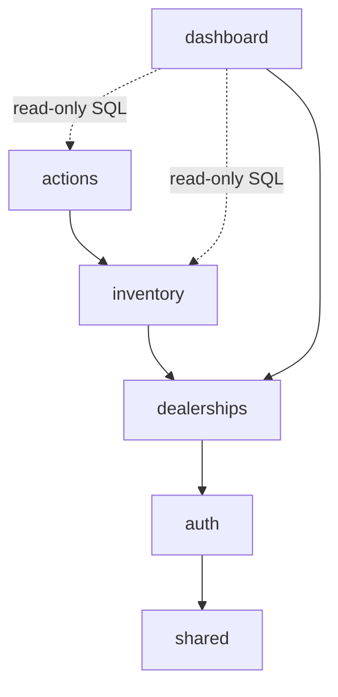
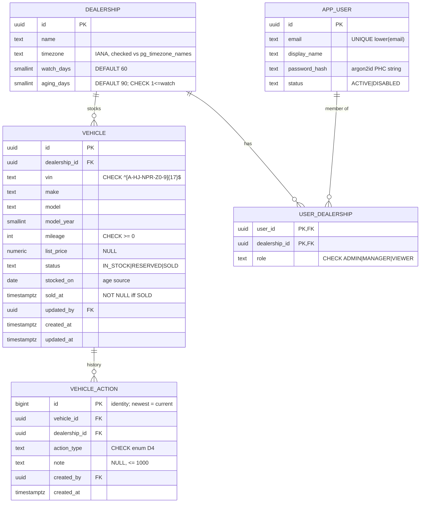
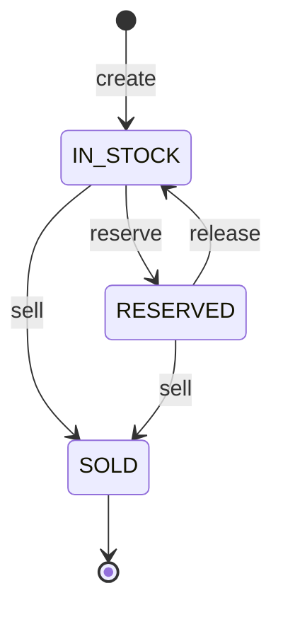
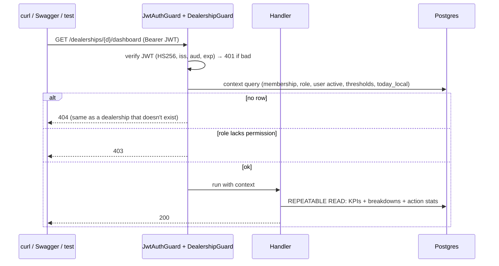
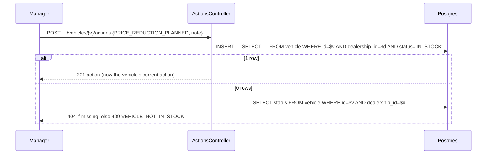
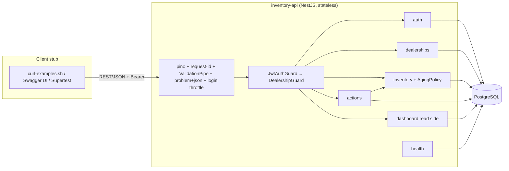

# Backend Architecture: Scenario B, the Intelligent Inventory Dashboard

Research and design note for the Keyloop technical assessment, backend layer. Sources are primary docs and specs, linked inline.
Status: revision 4, cut to one buildable MVP. Everything not in the MVP is in §6, "Alternatives and when we'd use them", which feeds the trade-off section of the System Design Document. Date: 2026-10-31.

---

## 0. What the brief asks (extracted from the PDF)

**Scenario B: The Intelligent Inventory Dashboard** (verbatim)

> • Domain: Supply
> • Task: Build an Intelligent Inventory Dashboard to give dealership managers a real-time overview of their vehicle stock.
> • Core Requirements:
>
> 1. Inventory Visualization: Display a filterable list of all vehicles in a dealership's inventory (e.g., filter by make, model, age).
> 2. Aging Stock Identification: Automatically identify and prominently display "aging stock" (vehicles in inventory for >90 days).
> 3. Actionable Insights: Allow a manager to log and persist a status or proposed action for each aging vehicle (e.g., "Price Reduction Planned").

**Backend-layer constraint** (verbatim)

> If you choose Backend: Expose a RESTful API and use a persistent database. Mock or stub the client-side layer with a simple test harness, cURL examples, or a basic API contract (e.g., OpenAPI spec).

**Build For the Future** (verbatim)

> Whichever layer you choose, your design and implementation should consider scalability, performance, reliability, maintainability, and observability.

**Ambiguity clause** (verbatim)

> If a requirement is unclear, please make a reasonable assumption and document it in your System Design Document.

**Deliverables** (condensed)

1. System Design Document: architecture diagram, each component's role, data flow, chosen technologies with justifications, an observability strategy ("logging, metrics, tracing"), and a section on how GenAI helped in the design phase.
2. Working code in a Git repo: a `README.md` with build/run/test steps, an "AI Collaboration Narrative" section, and "A suite of tests that validate the core business logic."
3. A 5–10 minute video: intro, design and implementation walkthrough, AI collaboration story (1–2 minutes), demo, lessons learned.

**Evaluation**: (1) Problem Solving & System Design, (2) Technical Execution, (3) AI Engineering & Verification ("a primary evaluation criterion"), (4) Communication & Presentation.

**Stack**: not mandated. TypeScript, to match the candidate's existing work.

---

## 1. Domain characteristics and what they drive

### 1.1 Actors

| Actor                            | Job                                                           | MVP interaction                                                         |
| -------------------------------- | ------------------------------------------------------------- | ----------------------------------------------------------------------- |
| **Manager**                      | Keep stock turning; act on aging stock before it costs margin | Dashboard, filtered list, log actions, add vehicles, mark reserved/sold |
| **Viewer** (sales / stock staff) | Know what's in stock and the plan for each car                | Read-only dashboard, list and action history                            |
| **Admin** (dealership)           | Configure the dealership                                      | Everything a Manager can, plus change the aging thresholds              |

Dealerships and users come from the seed script. Onboarding APIs are out of scope (§6).

### 1.2 Characteristics → decisions

| #   | Characteristic                                                                                                                     | MVP decision                                                                                                                                     |
| --- | ---------------------------------------------------------------------------------------------------------------------------------- | ------------------------------------------------------------------------------------------------------------------------------------------------ |
| 1   | **State is derived from time.** A vehicle becomes "aging" because a day passes, with no write.                                     | Store `stocked_on` (a date). Compute age and tier on every read from _today in the dealership's time zone_. No stored tier flag, no nightly job. |
| 2   | **Read-heavy, polled.** Dashboards poll every 10 s; writes are tens per dealership per day.                                        | Every read is computed fresh with indexed queries. No cache layer at this load (§1.3).                                                           |
| 3   | **Multi-tenant.** A user can belong to several dealerships with a different role in each. Data must never leak across dealerships. | `dealership_id` on every row, path and query. One membership check per request. `404` for non-members.                                           |
| 4   | **Decisions get revisited.** Managers change their mind about a car; two managers may act on the same car.                         | Actions are append-only. The latest entry is the current one; nothing is ever overwritten, so there is no lost update to prevent.                |
| 5   | **Small team, time-boxed build.**                                                                                                  | One modular monolith, one Postgres, five tables. Each growth path in §6 starts from a seam that already exists.                                  |

### 1.3 Sizing assumptions

|                                       | Value                      |
| ------------------------------------- | -------------------------- |
| Dealerships                           | 50                         |
| In-stock vehicles per dealership      | avg 300, max 2,000         |
| Open dashboards per dealership (peak) | 5                          |
| Polling load (50 × 5 × 6 req/min)     | 1,500 req/min ≈ **25 rps** |
| Writes                                | ~50 actions/day/dealership |

At 25 rps, each poll runs one aggregate over ≤ 2,000 rows (milliseconds). One API instance plus one Postgres has large headroom, so caching, ETags and push are deferred with explicit triggers (§6).

### 1.4 Quality targets (measurable)

| Quality         | Target                                                                                                                                                                               |
| --------------- | ------------------------------------------------------------------------------------------------------------------------------------------------------------------------------------ |
| Scalability     | The API is stateless (JWT, no in-process session), so adding replicas needs no code change.                                                                                          |
| Performance     | `GET …/dashboard` and a 50-row list page at 2,000 in-stock vehicles: **p95 ≤ 300 ms** (verified with `EXPLAIN ANALYZE` on a 20k-vehicle seed in the README).                         |
| Reliability     | DB constraints are the last line of defence. A status change can't race into an illegal state. `SIGTERM` drains in-flight requests. DB down → readiness fails, liveness stays green. |
| Maintainability | Adding an action type or a permission = one enum value + one map entry + tests. Aging rules live in one pure function with boundary tests.                                           |
| Observability   | Any `5xx` can be traced from the error body's `instance` to its log line in under 1 minute.                                                                                          |

---

## 2. Decisions and assumptions

**U** = user decision. **A** = my assumption (to be listed in the design doc).

| #   | Topic                  | Decision                                                                                                                                                                                                                                                      | U/A                         |
| --- | ---------------------- | ------------------------------------------------------------------------------------------------------------------------------------------------------------------------------------------------------------------------------------------------------------- | --------------------------- |
| D1  | Age source             | Age counts from `stocked_on`, the date the vehicle arrived in _this_ dealership's stock, not `created_at`.                                                                                                                                                    | U                           |
| D2  | Day counting           | Calendar days in the dealership's time zone: `daysInStock = today_local − stocked_on`. See P1.                                                                                                                                                                | A                           |
| D3  | Tiers                  | `FRESH` < watch ≤ `WATCH` ≤ aging < `AGING`. Defaults watch 60, aging 90. One pair per dealership, `1 ≤ watch < aging ≤ 3650`.                                                                                                                                | U (bounds A)                |
| D4  | Actions                | Enum `PRICE_REDUCTION_PLANNED, TRANSFER, AUCTION, PROMOTION, MONITOR, OTHER` plus an optional note (≤ 1,000 chars). Append-only; the latest is current.                                                                                                       | U (note length A)           |
| D5  | Who can get actions    | Any `IN_STOCK` vehicle. Aging ones are highlighted, not required. `RESERVED`/`SOLD` → `409`.                                                                                                                                                                  | U (RESERVED rule A)         |
| D6  | Lifecycle              | `IN_STOCK ⇄ RESERVED`, either → `SOLD`. `SOLD` is terminal.                                                                                                                                                                                                   | U                           |
| D7  | List default           | `status=IN_STOCK`, oldest first. Filterable by status.                                                                                                                                                                                                        | U                           |
| D8  | Data sources           | Seed data plus `POST /vehicles` and a status change endpoint.                                                                                                                                                                                                 | U (CSV import deferred, §6) |
| D9  | "Real-time"            | Every read is computed fresh. The client polls every 10 s.                                                                                                                                                                                                    | U                           |
| D10 | Insights               | KPI summary (total in stock, count per tier, aging with no action, average days in stock), breakdowns by make/model and by bucket (0–30, 31–60, 61–90, 90+), current-action counts by type. No cost figure. Buckets are fixed, independent of the thresholds. | U (buckets A)               |
| D11 | "Aging with no action" | An aging `IN_STOCK` vehicle with no action ever logged. `MONITOR` counts as an action.                                                                                                                                                                        | A                           |
| D12 | KPI population         | `IN_STOCK` only. `RESERVED` and `SOLD` are excluded.                                                                                                                                                                                                          | U                           |
| D13 | Auth                   | Email + password (argon2id). One access JWT, 1 h, no refresh token. Login is rate-limited per IP.                                                                                                                                                             | U (TTL and no-refresh A)    |
| D14 | Password rule          | 15–128 characters, no composition rules.                                                                                                                                                                                                                      | U (max A)                   |
| D15 | Permissions            | Guards check **permissions**, never role names. Roles `ADMIN`, `MANAGER`, `VIEWER` and the role→permission map are hardcoded in code. Viewers can read action notes.                                                                                          | U                           |
| D16 | Tenancy                | `user_dealership(user_id, dealership_id, role)`. Non-member → `404`.                                                                                                                                                                                          | U                           |
| D17 | Provisioning           | Dealerships and users come from the seed script. No sign-up, no user or dealership API.                                                                                                                                                                       | A (scope cut)               |
| D18 | VIN                    | 17 chars, `[A-HJ-NPR-Z0-9]`, uppercased, immutable. Unique among _non-sold_ vehicles per dealership, so a re-acquired car gets a new row.                                                                                                                     | A                           |
| D19 | Who did what           | `vehicle_action.created_by/created_at` and `vehicle.updated_by/updated_at` are the audit trail in the MVP.                                                                                                                                                    | A                           |

---

## 3. The correctness problems worth getting right

### P1: Time-derived tiers must be time-zone-correct

- **Why local calendar days:** managers and DMS exports think in dates ("arrived 1 Aug"). A tier should flip at the dealership's midnight, not at UTC midnight (11:00 in Sydney). Subtracting two dates is immune to DST.
- **One time-zone source:** Postgres computes `today_local = (now() AT TIME ZONE d.timezone)::date` ([AT TIME ZONE](https://www.postgresql.org/docs/current/functions-datetime.html#FUNCTIONS-DATETIME-ZONECONVERT)). Node never does time-zone maths, so there is only one tzdata version in play. Time zones are validated against `pg_timezone_names` ([docs](https://www.postgresql.org/docs/current/view-pg-timezone-names.html)).
- **`stocked_on` is a `date` column.** `date − date` returns integer days ([datetime operators](https://www.postgresql.org/docs/current/functions-datetime.html)), and every age filter becomes a plain, indexable date comparison.
- **`AgingPolicy`** (pure TypeScript, no I/O) owns `tierOf`, `bucketOf`, `validateThresholds` and `toStockedOnBounds` (turns "tier = AGING" or "age 30–60" into `stocked_on` bounds). SQL only receives the bounds. This is the core business logic and gets the most tests.
- **Testability:** `now` comes from an injected `Clock` and is passed into the SQL as a parameter, so tests can pin the date.

### P2: Status changes must not race into an illegal state

`UPDATE vehicle SET status = $new … WHERE id = $v AND dealership_id = $d AND status = ANY($allowedFrom) RETURNING *`. The database checks the transition atomically. 0 rows → look up the vehicle: missing → `404`, otherwise `409 INVALID_TRANSITION`. No `If-Match`, no locks.

Logging an action uses the same pattern: `INSERT … SELECT … FROM vehicle WHERE id = $v AND dealership_id = $d AND status = 'IN_STOCK'`. A vehicle sold a millisecond earlier can't receive an action.

### P3: Two managers act on the same car

Both inserts succeed and both stay in the history. "Current" is the newest by `id`. Nothing is silently lost, because nothing is overwritten; the second manager sees the first one's entry in the history. Rejecting the second write (`If-Match`/`412`) is in §6 with its trigger.

---

## 4. MVP architecture

### 4.1 Stack

| Concern     | Choice                                                                                                                         | Why                                                                                                                                                                                                                                                                                                                                                                                         |
| ----------- | ------------------------------------------------------------------------------------------------------------------------------ | ------------------------------------------------------------------------------------------------------------------------------------------------------------------------------------------------------------------------------------------------------------------------------------------------------------------------------------------------------------------------------------------- |
| Runtime     | Node.js 24 LTS (≥ 24.7) + TypeScript strict                                                                                    | Built-in `crypto.argon2` (added in v24.7.0, supports `argon2id`) ([Node crypto](https://nodejs.org/api/crypto.html)), so no native addon.                                                                                                                                                                                                                                                   |
| Framework   | NestJS 12                                                                                                                      | Modules and DI give clear boundaries ([modules](https://docs.nestjs.com/modules)). `ValidationPipe` ([docs](https://docs.nestjs.com/techniques/validation)), OpenAPI from decorators ([docs](https://docs.nestjs.com/openapi/introduction)), Terminus health checks ([docs](https://docs.nestjs.com/recipes/terminus)), throttler ([docs](https://docs.nestjs.com/security/rate-limiting)). |
| DB          | PostgreSQL (pinned image tag)                                                                                                  | Transactions, constraints, partial indexes, `LATERAL`, aggregate `FILTER`, `AT TIME ZONE`.                                                                                                                                                                                                                                                                                                  |
| Data access | Drizzle ORM + drizzle-kit SQL migrations                                                                                       | SQL-first, typed `sql` templates ([docs](https://orm.drizzle.team/docs/sql)), transactions with isolation level ([docs](https://orm.drizzle.team/docs/transactions)), migrations ([docs](https://orm.drizzle.team/docs/migrations)).                                                                                                                                                        |
| JWT         | `@nestjs/jwt`, HS256, 256-bit secret, algorithm allowlist, `iss`/`aud`/`exp` checked                                           | RFC 8725 §3.1: libraries "MUST enable the caller to specify a supported set of algorithms" ([RFC 8725](https://www.rfc-editor.org/rfc/rfc8725)).                                                                                                                                                                                                                                            |
| Logging     | `nestjs-pino`                                                                                                                  | Request-scoped JSON logs, request IDs, redaction ([repo](https://github.com/iamolegga/nestjs-pino)).                                                                                                                                                                                                                                                                                        |
| Errors      | RFC 9457 problem+json via one exception filter                                                                                 | One error shape for every client ([RFC 9457](https://www.rfc-editor.org/rfc/rfc9457)).                                                                                                                                                                                                                                                                                                      |
| Tests       | Vitest + Supertest + Testcontainers `@testcontainers/postgresql` ([docs](https://node.testcontainers.org/modules/postgresql/)) | Date maths and SQL filters need a real Postgres.                                                                                                                                                                                                                                                                                                                                            |
| Packaging   | Multi-stage Dockerfile + `docker-compose.yml` (api, postgres)                                                                  | One command for reviewers.                                                                                                                                                                                                                                                                                                                                                                  |

### 4.2 Modules

| Module        | Owns                          | Contains                                                                                                                                    |
| ------------- | ----------------------------- | ------------------------------------------------------------------------------------------------------------------------------------------- |
| `shared`      | —                             | Config (validated at startup), Drizzle provider, `Clock`, problem+json filter                                                               |
| `auth`        | `app_user`, `user_dealership` | Login, `JwtAuthGuard`, `DealershipGuard` (membership + permission), `@RequirePermission`, `Permission` enum, role→permission map, `GET /me` |
| `dealerships` | `dealership`                  | Settings read/update (time zone, thresholds)                                                                                                |
| `inventory`   | `vehicle`                     | Create, status change, list, detail, `VehicleStatus` transitions, `AgingPolicy`                                                             |
| `actions`     | `vehicle_action`              | Log action, action history                                                                                                                  |
| `dashboard`   | — (read only)                 | Dashboard aggregate query                                                                                                                   |
| `health`      | —                             | `/health/live`, `/health/ready`                                                                                                             |

Rules: only the owning module writes a table; `dashboard` is the only module that reads across tables; no cycles. No ESLint boundary enforcement and no facade layer at this size (§6).



### 4.3 Data model (5 tables)



| Index / constraint                                           | Serves                                                                                                                                     |
| ------------------------------------------------------------ | ------------------------------------------------------------------------------------------------------------------------------------------ |
| `vehicle UNIQUE (dealership_id, vin) WHERE status <> 'SOLD'` | D18                                                                                                                                        |
| `vehicle (dealership_id, status, stocked_on)`                | Default list order, tier and age filters, dashboard scan ([multicolumn](https://www.postgresql.org/docs/current/indexes-multicolumn.html)) |
| `vehicle (dealership_id, lower(make), lower(model))`         | Make/model filters ([expression indexes](https://www.postgresql.org/docs/current/indexes-expressional.html))                               |
| `vehicle CHECK ((status = 'SOLD') = (sold_at IS NOT NULL))`  | Lifecycle integrity                                                                                                                        |
| `vehicle_action (vehicle_id, id DESC)`                       | "Latest action" with a backward index scan, `LIMIT 1`                                                                                      |
| `user_dealership` PK `(user_id, dealership_id)`              | Per-request membership lookup                                                                                                              |

### 4.4 Aging policy and queries

```ts
// inventory/domain/aging-policy.ts. Pure: no I/O, no time zones.
export type Tier = 'FRESH' | 'WATCH' | 'AGING';
export const tierOf = (
  days: number,
  t: { watch: number; aging: number },
): Tier => (days > t.aging ? 'AGING' : days >= t.watch ? 'WATCH' : 'FRESH');
export const bucketOf = (d: number) =>
  d <= 30 ? '0-30' : d <= 60 ? '31-60' : d <= 90 ? '61-90' : '90+';
// days >= N ⇔ stocked_on <= today − N ;  days <= M ⇔ stocked_on >= today − M
// AGING ⇔ stocked_on < today − aging ;  WATCH ⇔ today − aging <= stocked_on <= today − watch ;  FRESH ⇔ stocked_on > today − watch
```

**Request context** (run by `DealershipGuard`, one query, also gives the handler `today_local` and thresholds):

```sql
SELECT m.role, d.timezone, d.watch_days, d.aging_days,
       ($now::timestamptz AT TIME ZONE d.timezone)::date AS today_local
FROM user_dealership m
JOIN app_user u   ON u.id = m.user_id AND u.status = 'ACTIVE'
JOIN dealership d ON d.id = m.dealership_id
WHERE m.user_id = $userId AND m.dealership_id = $dealershipId;   -- 0 rows ⇒ 404
```

Because the user's status and membership are read on every request, disabling a user or removing a membership takes effect immediately, even though the JWT is still valid.

**List** (the `WHERE` is built from the filters present):

```sql
SELECT v.id, v.vin, v.make, v.model, v.model_year, v.mileage, v.list_price, v.status, v.stocked_on,
       CASE WHEN v.status = 'SOLD' THEN (v.sold_at AT TIME ZONE $tz)::date - v.stocked_on
            ELSE $today::date - v.stocked_on END AS days_in_stock,
       la.action_type, la.note, la.created_by, la.created_at AS action_at,
       count(*) OVER () AS total
FROM vehicle v
LEFT JOIN LATERAL (SELECT action_type, note, created_by, created_at
                   FROM vehicle_action a WHERE a.vehicle_id = v.id
                   ORDER BY a.id DESC LIMIT 1) la ON true
WHERE v.dealership_id = $d
  AND v.status = ANY($statuses)                                       -- default {IN_STOCK}
  AND lower(v.make) = lower($make) AND lower(v.model) = lower($model)
  AND v.stocked_on <= $stockedOnMax AND v.stocked_on >= $stockedOnMin -- from AgingPolicy
  AND (la.action_type IS NOT NULL) = $hasAction
ORDER BY v.stocked_on, v.id                                           -- oldest first; `newest` flips it
LIMIT $limit OFFSET $offset;                                          -- limit ≤ 100
```

`LATERAL` ([docs](https://www.postgresql.org/docs/current/queries-table-expressions.html#QUERIES-LATERAL)). The tier per row is computed in TypeScript with `tierOf`. Offset pagination is fine at ≤ 2,000 rows; keyset is in §6.

**Dashboard** (three statements in one `REPEATABLE READ, READ ONLY` transaction, so all sections come from one snapshot ([isolation](https://www.postgresql.org/docs/current/transaction-iso.html))):

```sql
WITH s AS (
  SELECT v.make, v.model, ($today::date - v.stocked_on) AS days, la.action_type
  FROM vehicle v
  LEFT JOIN LATERAL (SELECT action_type FROM vehicle_action a WHERE a.vehicle_id = v.id
                     ORDER BY a.id DESC LIMIT 1) la ON true
  WHERE v.dealership_id = $d AND v.status = 'IN_STOCK')
-- (1) KPIs + buckets
SELECT count(*)                                                       AS total_in_stock,
       count(*) FILTER (WHERE days <  $watch)                         AS fresh,
       count(*) FILTER (WHERE days BETWEEN $watch AND $aging)         AS watch,
       count(*) FILTER (WHERE days >  $aging)                         AS aging,
       count(*) FILTER (WHERE days >  $aging AND action_type IS NULL) AS aging_without_action,
       round(avg(days), 1)                                            AS avg_days_in_stock,
       count(*) FILTER (WHERE days <= 30)                             AS b_0_30,
       count(*) FILTER (WHERE days BETWEEN 31 AND 60)                 AS b_31_60,
       count(*) FILTER (WHERE days BETWEEN 61 AND 90)                 AS b_61_90,
       count(*) FILTER (WHERE days >  90)                             AS b_90_plus
FROM s;
-- (2) SELECT make, model, count(*), count(*) FILTER (WHERE days > $aging) AS aging FROM s GROUP BY 1,2 ORDER BY 3 DESC;
-- (3) SELECT coalesce(action_type, 'NONE'), count(*) FROM s GROUP BY 1;
```

Aggregate `FILTER` ([syntax](https://www.postgresql.org/docs/current/sql-expressions.html#SYNTAX-AGGREGATES)).

### 4.5 Vehicle lifecycle



Any other transition, including same-state → `409 INVALID_TRANSITION`. Selling sets `sold_at`. Actions only on `IN_STOCK` (D5). A re-acquired VIN gets a new row with a new age.

### 4.6 Auth, permissions, tenancy

**Login** (`POST /auth/login`)

1. Throttled to 10/min per IP.
2. Look up by `lower(email)`. For an unknown email, verify against a dummy hash anyway so the response time doesn't reveal which emails exist ([OWASP Authentication](https://cheatsheetseries.owasp.org/cheatsheets/Authentication_Cheat_Sheet.html)).
3. Unknown user, wrong password and disabled user all return the same `401 INVALID_CREDENTIALS`.
4. Success → `{accessToken, expiresIn: 3600}`.

**Passwords:** argon2id at the OWASP minimum _m = 19 MiB, t = 2, p = 1_ ([OWASP Password Storage](https://cheatsheetseries.owasp.org/cheatsheets/Password_Storage_Cheat_Sheet.html)), via Node's `crypto.argon2`, stored as a PHC string, compared with `timingSafeEqual`. Seed passwords follow the 15-character minimum, the NIST rule for single-factor passwords ([SP 800-63B-4](https://pages.nist.gov/800-63-4/sp800-63b.html)).

**Access JWT:** claims `iss`, `aud`, `sub`, `iat`, `exp` (+1 h). No roles in the token: roles differ per dealership and are read on every request, so a changed role takes effect immediately.

**Permissions** (`auth/permissions.ts`; the map is a frozen constant):

| Permission                             | Admin | Manager | Viewer |
| -------------------------------------- | :---: | :-----: | :----: |
| `vehicle:read`                         |   ✓   |    ✓    |   ✓    |
| `dashboard:read`                       |   ✓   |    ✓    |   ✓    |
| `vehicle_action:read` (includes notes) |   ✓   |    ✓    |   ✓    |
| `settings:read`                        |   ✓   |    ✓    |   ✓    |
| `vehicle:create`                       |   ✓   |    ✓    |        |
| `vehicle:change_status`                |   ✓   |    ✓    |        |
| `vehicle_action:create`                |   ✓   |    ✓    |        |
| `settings:update`                      |   ✓   |         |        |

Controllers only write `@RequirePermission('vehicle_action:create')`. Replacing the map with a DB table later changes one function, `permissionsFor(role)`, and no controller (§6).

**Guard chain:** `JwtAuthGuard` (`401`) → `DealershipGuard`: runs the context query (no row → **`404`**), then checks the permission (`403`).

**Why `404` for non-members:** a `403` would confirm the dealership exists. RFC 9110 lets a server that wants to "hide" a forbidden resource "instead respond with a status code of 404" ([RFC 9110 §15.5.4](https://www.rfc-editor.org/rfc/rfc9110.html#name-403-forbidden)); this matches [OWASP API1:2023 BOLA](https://owasp.org/API-Security/editions/2023/en/0xa1-broken-object-level-authorization/). A member who lacks a permission gets `403`.

### 4.7 API (under `/api/v1`, JSON, OpenAPI at `/docs`)

`{d}` = dealershipId, `{v}` = vehicleId. Every error is problem+json (§4.8).

| Method & path                                | Permission              | Request → Response                                                                                                                                                                                                                          | Status                                                          |
| -------------------------------------------- | ----------------------- | ------------------------------------------------------------------------------------------------------------------------------------------------------------------------------------------------------------------------------------------- | --------------------------------------------------------------- |
| `POST /auth/login`                           | public, throttled       | `{email, password}` → `{accessToken, expiresIn}`                                                                                                                                                                                            | 200, 400, 401, 429                                              |
| `GET /me`                                    | authenticated           | → `{user, memberships:[{dealershipId, name, role, permissions[]}]}`                                                                                                                                                                         | 200, 401                                                        |
| `GET /dealerships/{d}/dashboard`             | `dashboard:read`        | → `{asOf, timezone, thresholds, summary{totalInStock, byTier{FRESH,WATCH,AGING}, agingWithoutAction, avgDaysInStock}, ageBuckets[], byMakeModel[{make, model, count, aging}], actionStats[{actionType\|NONE, count}]}`                      | 200, 401, 404                                                   |
| `GET /dealerships/{d}/vehicles`              | `vehicle:read`          | `status, make, model, tier, minAgeDays, maxAgeDays, hasAction, sort=oldest\|newest, limit≤100, offset` → `{items[{id, vin, make, model, modelYear, mileage, listPrice, status, stockedOn, daysInStock, tier, currentAction\|null}], total}` | 200, 400, 401, 404                                              |
| `GET /dealerships/{d}/vehicles/{v}`          | `vehicle:read`          | → vehicle with `daysInStock`, `tier`, `currentAction`                                                                                                                                                                                       | 200, 404                                                        |
| `POST /dealerships/{d}/vehicles`             | `vehicle:create`        | `{vin, make, model, modelYear, mileage, listPrice?, stockedOn}` → vehicle, `Location`                                                                                                                                                       | 201, 400, 404, 409 `VIN_ALREADY_IN_STOCK`                       |
| `PATCH /dealerships/{d}/vehicles/{v}/status` | `vehicle:change_status` | `{status}` → vehicle                                                                                                                                                                                                                        | 200, 400, 404, 409 `INVALID_TRANSITION`                         |
| `GET /dealerships/{d}/vehicles/{v}/actions`  | `vehicle_action:read`   | → `{items[...newest first]}`                                                                                                                                                                                                                | 200, 404                                                        |
| `POST /dealerships/{d}/vehicles/{v}/actions` | `vehicle_action:create` | `{actionType, note?}` → action, `Location`                                                                                                                                                                                                  | 201, 400, 404, 409 `VEHICLE_NOT_IN_STOCK`                       |
| `GET /dealerships/{d}/settings`              | `settings:read`         | → `{name, timezone, watchDays, agingDays, todayLocal}`                                                                                                                                                                                      | 200, 404                                                        |
| `PATCH /dealerships/{d}/settings`            | `settings:update`       | `{timezone?, watchDays?, agingDays?}` → settings                                                                                                                                                                                            | 200, 400, 403, 404, 422 `THRESHOLDS_INVALID`/`TIMEZONE_INVALID` |
| `GET /health/live`, `GET /health/ready`      | public                  | ready = DB ping                                                                                                                                                                                                                             | 200, 503                                                        |

Inventory reads send `Cache-Control: no-store`, so a poll always gets fresh data. `X-Request-ID` is echoed on every response.

### 4.8 Error model

```json
{
  "type": "https://api.example.dev/problems/invalid-transition",
  "title": "Conflict",
  "status": 409,
  "detail": "A SOLD vehicle cannot move to RESERVED.",
  "instance": "urn:request:9f1c2a…",
  "code": "INVALID_TRANSITION",
  "errors": [{ "pointer": "/status", "message": "…" }]
}
```

`instance` is the request ID, which is also on the log line. Codes: `400 VALIDATION_FAILED` (unknown fields rejected), `401 UNAUTHENTICATED`/`INVALID_CREDENTIALS`, `403 FORBIDDEN`, `404 NOT_FOUND` (missing resource or not a member), `409` (state conflicts, [RFC 9110 §15.5.10](https://www.rfc-editor.org/rfc/rfc9110.html#name-409-conflict)), `422` (valid shape, invalid meaning), `429 RATE_LIMITED`, `500 INTERNAL` (never leaks internals).

### 4.9 Sequence diagrams

**Any dealership request**



**Logging an action**



### 4.10 Architecture



### 4.11 The five qualities in the MVP

| Quality         | What the MVP does                                                                                                                                                                                                                                                                                                                                         | What it deliberately doesn't (→ §6)                             |
| --------------- | --------------------------------------------------------------------------------------------------------------------------------------------------------------------------------------------------------------------------------------------------------------------------------------------------------------------------------------------------------- | --------------------------------------------------------------- |
| Scalability     | Stateless API: JWT, nothing in process except the login throttler. Tenant-scoped indexes.                                                                                                                                                                                                                                                                 | Replicas, caching, read replicas, push                          |
| Performance     | Sargable `stocked_on` ranges, composite and partial indexes, `FILTER` aggregates over ≤ 2k rows, one context query per request. `EXPLAIN ANALYZE` at 20k vehicles in the README.                                                                                                                                                                          | ETag/304, keyset pagination                                     |
| Reliability     | CHECK/PK/FK/partial UNIQUE constraints. Atomic, race-free status changes and action inserts. Startup config validation. Live/ready probes. Graceful shutdown ([lifecycle](https://docs.nestjs.com/fundamentals/lifecycle-events#application-shutdown)). `statement_timeout` ([docs](https://www.postgresql.org/docs/current/runtime-config-client.html)). | Idempotency keys, optimistic concurrency                        |
| Maintainability | Small modules with owned tables. One `AgingPolicy`. Permissions as data and as the RBAC test fixture. A test for every business rule. OpenAPI generated from code.                                                                                                                                                                                        | Ports for ingestion, lint-enforced boundaries                   |
| Observability   | Structured JSON logs with request ID, user and dealership on every line; redacted secrets; the error `instance` links to the log line; health endpoints.                                                                                                                                                                                                  | Metrics and tracing (designed in §5, built only if time allows) |

### 4.12 Folder structure

```
apps/api/                  # the monolith (Turborepo workspace package @inventory/api)
├─ src/
│  ├─ main.ts              # pino, ValidationPipe, problem filter, swagger, enableShutdownHooks
│  ├─ app.module.ts
│  ├─ shared/{config.ts, clock.ts, db.ts, schema.ts, problem-details.filter.ts}
│  └─ modules/             # domain/ = pure rules, no I/O, 100% coverage
│     ├─ auth/{auth.controller.ts, auth.service.ts, jwt-auth.guard.ts, dealership.guard.ts, password.ts, domain/permissions.ts}
│     ├─ dealerships/{settings.controller.ts, settings.service.ts}
│     ├─ inventory/{vehicles.controller.ts, vehicles.service.ts, domain/{aging-policy.ts, vehicle-status.ts, vin.ts}}
│     ├─ actions/{actions.controller.ts, actions.service.ts, action-type.ts}
│     ├─ dashboard/{dashboard.controller.ts, dashboard.query.ts}
│     └─ health/health.controller.ts
├─ db/{migrations/, seed.ts}
├─ test/{unit/, integration/}
└─ Dockerfile, .env.example
docs/api/{openapi.json, curl-examples.sh}
docker-compose.yml, README.md   # repo root
```

### 4.13 Configuration (validated at startup)

| Env var                   | Default        | Notes                       |
| ------------------------- | -------------- | --------------------------- |
| `PORT`, `LOG_LEVEL`       | `3000`, `info` |                             |
| `DATABASE_URL`            | —              | required                    |
| `DB_STATEMENT_TIMEOUT_MS` | `5000`         |                             |
| `JWT_SECRET`              | —              | required, ≥ 32 random bytes |
| `JWT_TTL_S`               | `3600`         |                             |

### 4.14 Seed data (`pnpm db:seed`, idempotent)

- **Dealerships:** `Europe/London` (60/90), `America/New_York` (45/75, to show per-dealership thresholds), `Australia/Sydney` (60/90).
- **Users:** `admin@…` (Admin in all three), `manager@…` (Manager in London and New York), `viewer@…` (Viewer in London). Passwords come from env or are printed once.
- **Vehicles:** about 250 per dealership, ages 0–200 days, with boundary vehicles at exactly watch−1, watch, aging and aging+1 days, some `RESERVED`/`SOLD`, and one re-acquired VIN.
- **Actions:** history on about 40% of aging vehicles; some have several entries to show "latest is current".
- **Load option:** `SEED_VEHICLES_PER_DEALERSHIP=20000` for the README's `EXPLAIN ANALYZE`.

### 4.15 Tests (mapped to business rules)

| Rule                   | Test                                                                                                                                       | Level              |
| ---------------------- | ------------------------------------------------------------------------------------------------------------------------------------------ | ------------------ |
| D3 tiers               | `tierOf` at watch−1, watch, aging, aging+1; threshold validation                                                                           | unit               |
| D10 buckets            | Edges 30/31, 60/61, 90/91                                                                                                                  | unit               |
| D2/P1 day counting     | Clock pinned at 23:30 vs 00:30 New York time gives different `today_local`; London DST week doesn't shift the count                        | integration        |
| Filters                | Each list filter, tier and age bounds match `tierOf` on the returned rows; tenant isolation                                                | integration        |
| Dashboard parity       | Dashboard tier counts == `tierOf` applied to every listed vehicle, over the seed                                                           | integration        |
| D11/D12 KPIs           | `agingWithoutAction` excludes any vehicle with an action; RESERVED/SOLD excluded                                                           | integration        |
| D4/P3 actions          | Latest is current; two concurrent posts both persist                                                                                       | integration        |
| D5 eligibility         | RESERVED/SOLD → 409; FRESH in-stock → 201                                                                                                  | integration        |
| D6/P2 lifecycle        | Every allowed and forbidden transition; concurrent sell + reserve → one wins, one 409                                                      | unit + integration |
| D18 VIN                | Format, uppercasing, uniqueness among non-sold, re-acquisition                                                                             | unit + integration |
| D13 login              | Same 401 for unknown user, wrong password, disabled user; expired token → 401                                                              | integration        |
| D15/D16 RBAC + tenancy | Table-driven: every route × every role (the permission table is the fixture). Non-member → 404 with the same body as a missing dealership. | integration        |

### 4.16 Build order

1. Skeleton: config, DB, migrations, health, problem+json, pino, Docker Compose.
2. `AgingPolicy` with unit tests; vehicles list and detail; seed.
3. Dashboard query.
4. Actions.
5. Auth: login, JWT guard, dealership guard, permissions, `/me`.
6. Vehicle create, status change, settings.
7. README (build/run/test, AI narrative, `EXPLAIN ANALYZE`), `curl-examples.sh`, exported `openapi.json`.

**Stretch, only if time is left:** OpenTelemetry tracing + metrics (§5.2).

---

## 5. Observability strategy (for the design doc)

### 5.1 Built in the MVP: logs

- One JSON line per request: `time, level, msg, req_id, user_id, dealership_id, route, method, status, duration_ms`.
- Redacted: `authorization`, `*.password`.
- `warn` on failed logins; `error` with stack on `5xx`.
- The problem+json `instance` equals `req_id`, so an error a user reports leads straight to its log line.

### 5.2 Designed, built when deployed: metrics and traces

- **Traces:** OpenTelemetry Node SDK + auto-instrumentation loaded with `--import` gives HTTP and pg spans with no code changes ([docs](https://opentelemetry.io/docs/languages/js/getting-started/nodejs/)). Manual spans on `dashboard.query`. W3C `traceparent` propagation ([Trace Context](https://www.w3.org/TR/trace-context/)). The pino instrumentation adds `trace_id` to log lines.
- **Metrics:** the standard `http.server.request.duration` histogram per route ([semconv](https://opentelemetry.io/docs/specs/semconv/http/http-metrics/)) for RED; business counters `vehicle_action.logged{action_type}` and `auth.login.attempts{result}`; DB pool gauge.
- **SLOs to start with** ([SRE book](https://sre.google/sre-book/service-level-objectives/)): 99.9% non-5xx on dashboard and list over 28 days; p95 ≤ 300 ms.
- **Trigger to build:** the first deployment beyond a laptop. Until then, logs answer every question the demo raises.

---

## 6. Alternatives and when we'd use them

This is the source for the design doc's trade-off section. Each row says what the MVP does, what the alternative is, the signal that would make us switch, and what in the MVP makes the switch cheap.

### 6.1 Auth and access

| Topic                 | MVP                                                                                                                    | Alternative                                                                                                                                                                                                                                                    | Use it when                                                      | Why it's cheap later                                                                                                          |
| --------------------- | ---------------------------------------------------------------------------------------------------------------------- | -------------------------------------------------------------------------------------------------------------------------------------------------------------------------------------------------------------------------------------------------------------- | ---------------------------------------------------------------- | ----------------------------------------------------------------------------------------------------------------------------- |
| Session length        | One 1 h access JWT; user logs in again                                                                                 | Short access JWT (15 min) + rotating refresh token in an `HttpOnly; Secure; SameSite=Strict` cookie, stored hashed, with reuse detection that revokes the session ([RFC 9700 §4.14.2](https://www.rfc-editor.org/rfc/rfc9700#section-4.14.2))                  | A real SPA ships and users stay logged in all day                | Login already issues the token; refresh is a new endpoint and table                                                           |
| Logout / revocation   | Client discards the token; disabled users and removed memberships are cut off on the next request by the context query | Server-side `auth_session` checked per request                                                                                                                                                                                                                 | Immediate logout is required (shared devices, security incident) | The context query already runs per request; one join added                                                                    |
| Login hardening       | Per-IP throttle, generic 401, dummy hash                                                                               | Account lockout, breached-password blocklist, MFA (TOTP, [RFC 6238](https://www.rfc-editor.org/rfc/rfc6238))                                                                                                                                                   | Internet-facing production                                       | Isolated in `auth`                                                                                                            |
| SSO                   | Email + password                                                                                                       | OIDC Authorization Code + PKCE against the dealer group's IdP ([OIDC Core](https://openid.net/specs/openid-connect-core-1_0.html), [RFC 7636](https://www.rfc-editor.org/rfc/rfc7636)); SCIM provisioning ([RFC 7644](https://www.rfc-editor.org/rfc/rfc7644)) | A dealer group asks for it                                       | A second login method issuing the same JWT                                                                                    |
| Roles                 | Three hardcoded roles in a `CHECK` column, map in code                                                                 | `role` + `role_permission` tables and a role-admin API (custom roles); system roles protected                                                                                                                                                                  | Dealers ask for custom roles                                     | Guards check permissions, never role names; only `permissionsFor(role)` changes, plus a migration from role codes to role ids |
| User management       | Seed only                                                                                                              | Admin API to invite users, change roles, remove members (with a "last admin" check)                                                                                                                                                                            | More than a demo's worth of users                                | `user_dealership` already models membership                                                                                   |
| Dealership onboarding | Seed only                                                                                                              | Platform-scoped `PLATFORM_ADMIN` role that creates dealerships and assigns the first Admin, with **no implicit access** to dealership data (an explicit, audited membership is needed)                                                                         | Onboarding dealerships without a deploy                          | Same permission guard, scoped by permission                                                                                   |
| Tenant isolation      | `dealership_id` in every query + guard                                                                                 | Postgres row-level security as defence in depth; note table owners bypass RLS unless `FORCE ROW LEVEL SECURITY` ([RLS](https://www.postgresql.org/docs/current/ddl-rowsecurity.html))                                                                          | Many teams writing queries, or compliance asks                   | `dealership_id` is already on every row                                                                                       |
| JWT signing           | HS256, one secret                                                                                                      | EdDSA/ES256 with a published JWKS and `kid` rotation                                                                                                                                                                                                           | Other services must verify tokens                                | `@nestjs/jwt` config                                                                                                          |

### 6.2 Data, consistency and audit

| Topic              | MVP                                         | Alternative                                                                                                                                                                                                                                                                                                                 | Use it when                                                                                  | Why it's cheap later                                         |
| ------------------ | ------------------------------------------- | --------------------------------------------------------------------------------------------------------------------------------------------------------------------------------------------------------------------------------------------------------------------------------------------------------------------------- | -------------------------------------------------------------------------------------------- | ------------------------------------------------------------ |
| Concurrent actions | Both persist; newest is current             | `If-Match` with a per-vehicle sequence: `428` without it, `412` when stale ([RFC 9110 §13.1.1](https://www.rfc-editor.org/rfc/rfc9110.html#name-if-match), [RFC 6585](https://www.rfc-editor.org/rfc/rfc6585))                                                                                                              | Managers report conflicting decisions, or actions start triggering real work (price changes) | Append-only table; add a `seq` column and a unique key       |
| Vehicle edits      | Create + status change only; no field edits | `PATCH` with a `version` column and `If-Match`                                                                                                                                                                                                                                                                              | Data entry happens here rather than in the DMS                                               | Add a column and the guarded `UPDATE`                        |
| Audit              | `created_by`/`updated_by` + action history  | `audit_event` table written in the same transaction as every change                                                                                                                                                                                                                                                         | Compliance, or edits beyond status                                                           | Every write is already one transaction                       |
| Retries            | None                                        | `Idempotency-Key` on POSTs ([IETF draft](https://datatracker.ietf.org/doc/draft-ietf-httpapi-idempotency-key-header/))                                                                                                                                                                                                      | Mobile or flaky-network clients                                                              | Write handlers are already single-transaction                |
| Thresholds         | One pair per dealership                     | Per vehicle class (new vs used)                                                                                                                                                                                                                                                                                             | Managers ask for it                                                                          | `tierOf` already takes thresholds as input                   |
| Data ingestion     | Seed + create API                           | CSV import (upsert by VIN, delta, per-row report, one transaction for valid rows), then a DMS adapter (scheduled pull or webhook) behind a `VehicleIngestionPort`; large feeds as async jobs claimed with `FOR UPDATE SKIP LOCKED` ([SELECT](https://www.postgresql.org/docs/current/sql-select.html#SQL-FOR-UPDATE-SHARE)) | Real dealership data arrives                                                                 | The unique `(dealership_id, vin)` index is the upsert target |
| Events             | None                                        | Transactional outbox ([pattern](https://microservices.io/patterns/data/transactional-outbox.html)) → broker; events `VehicleStocked`, `VehicleStatusChanged`, `VehicleActionLogged`                                                                                                                                         | Another system needs to react (pricing, notifications)                                       | Every write is one transaction to add the outbox insert to   |

### 6.3 Performance and scale

| Topic        | MVP                             | Alternative                                                                                                                                                                                                                                                                                                                                                                         | Use it when                                                    | Why it's cheap later                                    |
| ------------ | ------------------------------- | ----------------------------------------------------------------------------------------------------------------------------------------------------------------------------------------------------------------------------------------------------------------------------------------------------------------------------------------------------------------------------------- | -------------------------------------------------------------- | ------------------------------------------------------- |
| Polling cost | Fresh query every poll (25 rps) | Conditional GET: weak ETag over a per-dealership `inventory_version`, **the local date** and the thresholds, so it also changes at midnight with no write; `304` skips the queries ([RFC 9110 §13.1.2](https://www.rfc-editor.org/rfc/rfc9110.html#name-if-none-match), [§15.4.5](https://www.rfc-editor.org/rfc/rfc9110.html#name-304-not-modified))                               | Polling reaches hundreds of rps or DB CPU climbs               | The guard already loads thresholds and `today_local`    |
| Push         | 10 s polling                    | SSE ([WHATWG](https://html.spec.whatwg.org/multipage/server-sent-events.html)) fed by Postgres `LISTEN/NOTIFY` (delivered only on commit, [NOTIFY](https://www.postgresql.org/docs/current/sql-notify.html)) plus a midnight tick per time zone                                                                                                                                     | 10 s is too slow for users, or polling load dominates          | Same queries; push only says "refetch"                  |
| Pagination   | `LIMIT/OFFSET`, ≤ 100           | Keyset on `(stocked_on, id)`; rows skipped by `OFFSET` "still have to be computed inside the server" ([LIMIT/OFFSET](https://www.postgresql.org/docs/current/queries-limit.html))                                                                                                                                                                                                   | Dealerships with tens of thousands of vehicles, or deep paging | The index already ends in `stocked_on`                  |
| Replicas     | One API instance                | N stateless replicas behind a gateway; rate limiting moves to the gateway or a shared store                                                                                                                                                                                                                                                                                         | Availability needs or CPU                                      | API is already stateless                                |
| DB scale     | One Postgres                    | PgBouncer (but `LISTEN` doesn't work in transaction pooling ([PgBouncer](https://www.pgbouncer.org/features.html))); a read replica for `dashboard`, which is "eventually consistent" ([hot standby](https://www.postgresql.org/docs/current/hot-standby.html))                                                                                                                     | DB CPU or connections saturate                                 | `dashboard` is already a separate read side             |
| Caching      | None                            | Redis for dashboard aggregates per dealership                                                                                                                                                                                                                                                                                                                                       | ETag isn't enough and aggregates get expensive                 | Dashboard is one query function                         |
| Services     | Modular monolith                | Split along the modules: Identity, Inventory (+ ingestion), Stock Actions, Dashboard Query with a projection fed by events ([decompose by subdomain](https://microservices.io/patterns/decomposition/decompose-by-subdomain.html), [CQRS](https://microservices.io/patterns/data/cqrs.html), [strangler](https://microservices.io/patterns/refactoring/strangler-application.html)) | Several teams, or ingestion and reads need to scale apart      | Modules own their tables; only `dashboard` reads across |
| Regions      | One                             | Region-pinned cells for data residency                                                                                                                                                                                                                                                                                                                                              | Customers in regulated regions                                 | `dealership_id` routing                                 |

### 6.4 Rejected outright

| Option                                            | Why not, at any scale                                                                                                                             |
| ------------------------------------------------- | ------------------------------------------------------------------------------------------------------------------------------------------------- |
| Stored tier flag + nightly job                    | Wrong between runs. A derived tier is always correct and costs one subtraction.                                                                   |
| UTC day counting                                  | Flips tiers mid-day for non-UTC dealerships; disagrees with DMS dates.                                                                            |
| Time-zone maths in Node                           | A second tzdata source that can disagree with Postgres.                                                                                           |
| Roles or permissions in the JWT                   | Differ per dealership, stale until expiry, token bloat.                                                                                           |
| Role-name checks in guards                        | Custom roles would mean editing every endpoint.                                                                                                   |
| `403` for non-members                             | Reveals which dealerships exist.                                                                                                                  |
| `is_platform_admin` boolean flag                  | Every guard has to special-case it; a platform-scoped role reuses the permission guard.                                                           |
| Implicit platform-admin access to all dealerships | Violates least privilege ([OWASP Authorization](https://cheatsheetseries.owasp.org/cheatsheets/Authorization_Cheat_Sheet.html)); unaudited reads. |

### 6.5 Technology alternatives

| Choice         | Alternative                     | Why the MVP choice                                                                                                                                                                                  |
| -------------- | ------------------------------- | --------------------------------------------------------------------------------------------------------------------------------------------------------------------------------------------------- |
| NestJS         | Express / Fastify alone         | Nest gives DI, guards, validation and OpenAPI generation for free, which the RBAC and module story need. Fastify is the upgrade if raw throughput matters (Nest supports it as a platform adapter). |
| Drizzle        | Prisma                          | Viable, but the `LATERAL`, `FILTER` and `AT TIME ZONE` SQL would be raw anyway; Drizzle keeps it typed.                                                                                             |
| PostgreSQL     | MongoDB                         | Relational data, constraints that enforce business rules, and date maths in the DB.                                                                                                                 |
| argon2id       | bcrypt                          | bcrypt truncates input at 72 bytes ([OWASP](https://cheatsheetseries.owasp.org/cheatsheets/Password_Storage_Cheat_Sheet.html)); argon2id is OWASP's first choice and built into Node.               |
| JWT            | Server-side session cookie only | A session cookie is simpler for one SPA; JWT was chosen so OIDC and other services can reuse the same token later.                                                                                  |
| Testcontainers | SQLite / mocks                  | The rules under test are SQL date maths and constraints; only real Postgres proves them.                                                                                                            |

---

## 7. Traceability

| Requirement                            | Design                                                                                        | Where                                                                                          |
| -------------------------------------- | --------------------------------------------------------------------------------------------- | ---------------------------------------------------------------------------------------------- |
| CR1 filterable list (make, model, age) | Tenant-scoped query; age and tier filters become `stocked_on` bounds                          | `GET …/vehicles`; `inventory/vehicles.service.ts`; index `(dealership_id, status, stocked_on)` |
| CR2 identify aging (>90 d)             | `today_local − stocked_on`, `tierOf` (AGING > aging threshold, default 90). No stored flag.   | `inventory/domain/aging-policy.ts`; `dealership.aging_days`                                    |
| CR2 prominently display                | Oldest-first default; `tier` on every item; dashboard `byTier.AGING` and `agingWithoutAction` | `GET …/dashboard`, `GET …/vehicles?tier=AGING`                                                 |
| CR3 log and persist an action          | Append-only `vehicle_action`, enum + note, latest is current                                  | `POST …/vehicles/{v}/actions`; `vehicle_action`                                                |
| REST + persistent DB                   | Resource URIs, RFC status codes, problem+json; Postgres with migrations                       | controllers; `db/migrations`                                                                   |
| Client stub                            | OpenAPI at `/docs`, committed `openapi.json`, `curl-examples.sh`                              | `docs/api/`                                                                                    |
| Tests of core logic                    | §4.15                                                                                         | `test/`                                                                                        |
| Login + hardcoded permissions          | §4.6                                                                                          | `auth` module                                                                                  |
| Build for the Future                   | §1.4, §4.11, §5, §6                                                                           | —                                                                                              |

---

## 8. Risks

1. **1 h token without refresh.** Users re-login hourly and logout is client-side. Acceptable for a demo; the refresh design is in §6.1.
2. **Concurrent actions both persist.** The "current" action is the newest, so a manager may not notice a colleague's decision a second earlier. It is visible in the history; `If-Match` is the fix (§6.2).
3. **In-memory login throttler.** Correct only with one replica. Mark it `shortcut:` in code.
4. **Time-zone change for a dealership.** Shifts `today_local` and may move tiers by a day. Rare and Admin-only.
5. **Dashboard runs on every poll.** Fine at 25 rps; the ETag trigger is in §6.3.

## 9. Interview points

1. **Time-derived state handled properly.** Tiers come from a stored date and a per-request local date computed by one time-zone source (Postgres). One pure `AgingPolicy` classifies. Boundary and DST tests prove it.
2. **The database enforces the rules.** Status transitions and action eligibility are atomic conditional writes; constraints back up the code.
3. **Permissions, not roles; 404, not 403.** Hardcoded today, replaceable by a table without touching a controller. Non-members can't learn a dealership exists.
4. **Scope by evidence.** Every deferred feature in §6 has a trigger and a seam. The MVP stays explainable in a 10-minute video.

## Appendix: earlier decisions deferred by the scope cut

These were chosen in earlier rounds and are now in §6 rather than the MVP:

| Earlier decision                                             | Now                                    |
| ------------------------------------------------------------ | -------------------------------------- |
| Refresh-token rotation with reuse detection, HttpOnly cookie | §6.1 Session length                    |
| Account lockout, password blocklist                          | §6.1 Login hardening                   |
| `role` table with system roles + `membership.role_id` FK     | §6.1 Roles (MVP uses a `CHECK` column) |
| Admin creates users via API                                  | §6.1 User management                   |
| Platform admin API creates dealerships                       | §6.1 Dealership onboarding             |
| CSV import (delta, upsert by VIN)                            | §6.2 Data ingestion                    |
| ETag/304 conditional polling                                 | §6.3 Polling cost                      |
| `If-Match` on actions                                        | §6.2 Concurrent actions                |
| `audit_event` table                                          | §6.2 Audit                             |
| Keyset pagination                                            | §6.3 Pagination                        |
| OpenTelemetry traces and metrics                             | §5.2 (stretch)                         |
