# System Design: Intelligent Inventory Dashboard (backend)

System Design Document for the Keyloop technical assessment, Scenario B, backend layer. It condenses the design in [`research/backend-architecture.md`](research/backend-architecture.md) (the "architecture doc") for a reviewer. Decision numbers (D1–D19, P1–P3) and section references (§) point back to it; it holds the reasoning and sources this page leaves out.

Status: the MVP is being built in the order of architecture doc §4.16. Today the repo has the skeleton, the `health` module and `AgingPolicy` with its unit tests; everything else on this page is the design being built.

---

## 1. Problem and scope

Dealership managers need a live view of their vehicle stock:

1. **Inventory list**, filterable by make, model, age, tier and status (D7).
2. **Aging stock**: vehicles in stock longer than the dealership's aging threshold (default 90 days) are flagged on every read and summed up on the dashboard (D3, D10).
3. **Actions**: a manager logs a proposed action per vehicle (e.g. `PRICE_REDUCTION_PLANNED`), kept as an append-only history (D4).

The backend is a REST API on PostgreSQL. The client is stubbed with Swagger UI (OpenAPI at `/docs`), `curl-examples.sh` and Supertest.

**Sizing (§1.3):** 50 dealerships, ≤ 2,000 in-stock vehicles each, dashboards polled every 10 s (D9), about 25 requests/s at peak, about 50 writes per dealership per day. One API instance and one Postgres have plenty of headroom, so the MVP adds no cache, queue or second service.

**Targets (§1.4):** dashboard and list p95 ≤ 300 ms at 2,000 in-stock vehicles; a status change can't race into an illegal state; any `5xx` can be traced from its error body to its log line in under a minute.

---

## 2. Architecture

A **modular monolith**: one stateless NestJS process (`apps/api`), one PostgreSQL database, five tables.



_Figure 1. Containers and modules. The auth guards gate every dealership route; each module writes only its own table, and `dashboard` reads across tables._

### 2.1 Components

| Component     | Owns (writes)                 | Role                                                                                                                                                                                                                                                                                                      |
| ------------- | ----------------------------- | --------------------------------------------------------------------------------------------------------------------------------------------------------------------------------------------------------------------------------------------------------------------------------------------------------- |
| Client stub   | —                             | Swagger UI, `curl-examples.sh` and Supertest stand in for the dashboard front end (brief: backend only).                                                                                                                                                                                                  |
| `auth`        | `app_user`, `user_dealership` | `POST /auth/login` (argon2id, per-IP throttle, D13), `GET /me`. `JwtAuthGuard` (401) and `DealershipGuard`, which runs one context query per request: membership (404 if none), role → permission check (403), thresholds and `today_local` (§4.6). The role → permission map is a frozen constant (D15). |
| `dealerships` | `dealership`                  | Read and update settings: time zone (checked against `pg_timezone_names`) and the watch/aging thresholds (D3).                                                                                                                                                                                            |
| `inventory`   | `vehicle`                     | Create a vehicle, change its status (D6), list with filters, detail. Holds the pure `AgingPolicy` and `VehicleStatus` rules in `domain/`.                                                                                                                                                                 |
| `actions`     | `vehicle_action`              | Log an action and read the history. Append-only; the newest by `id` is the current one (D4, P3).                                                                                                                                                                                                          |
| `dashboard`   | — (read-only)                 | The KPI aggregate (D10–D12). The only module that reads across tables.                                                                                                                                                                                                                                    |
| `health`      | —                             | `/health/live` and `/health/ready` (Terminus). Public, outside the guards.                                                                                                                                                                                                                                |
| `shared`      | —                             | Config validated at startup, the Drizzle provider, the injected `Clock`, the RFC 9457 exception filter and the pino logger setup.                                                                                                                                                                         |
| PostgreSQL    | the five tables               | The system of record. Also the only place that does time-zone maths (P1) and the place where state rules are enforced (constraints, conditional writes; P2).                                                                                                                                              |

Module rules (§4.2): only the owning module writes a table, `dashboard` is the only cross-table reader, no dependency cycles: `dealerships` depends on `auth`, `inventory` on `dealerships`, `actions` on `inventory`, `dashboard` on `dealerships`.

### 2.2 Data model

| Table             | Holds                                                                                                       | Key constraints                                                                                                       |
| ----------------- | ----------------------------------------------------------------------------------------------------------- | --------------------------------------------------------------------------------------------------------------------- |
| `dealership`      | Name, IANA `timezone`, `watch_days` (60), `aging_days` (90)                                                 | `CHECK 1 ≤ watch < aging ≤ 3650`                                                                                      |
| `app_user`        | Email, display name, argon2id hash, `ACTIVE`/`DISABLED`                                                     | `UNIQUE lower(email)`                                                                                                 |
| `user_dealership` | Membership and role (`ADMIN`, `MANAGER`, `VIEWER`) per dealership (D16)                                     | PK `(user_id, dealership_id)`                                                                                         |
| `vehicle`         | VIN, make, model, year, mileage, price, `status`, **`stocked_on` (date)**, `sold_at`, `updated_by/at` (D19) | Partial `UNIQUE (dealership_id, vin) WHERE status <> 'SOLD'` (D18); `CHECK (status = 'SOLD') = (sold_at IS NOT NULL)` |
| `vehicle_action`  | `action_type` (enum, D4), optional note ≤ 1,000 chars, `created_by/at`                                      | Identity `id`; index `(vehicle_id, id DESC)` for "latest action"                                                      |

Every row carries `dealership_id`, and every query filters on it. There is no stored age or tier column (§3.2).

---

## 3. Data flow

### 3.1 A request, end to end

1. **Edge.** `nestjs-pino` assigns a request ID (echoed as `X-Request-ID`) and binds it to every log line of the request. `ValidationPipe` rejects unknown fields and bad shapes (400).
2. **Guards.** `JwtAuthGuard` verifies the token (HS256 only, `iss`/`aud`/`exp`; RFC 8725) or returns 401. `DealershipGuard` runs the context query below. No row → **404**, so a non-member can't tell whether a dealership exists ([RFC 9110 §15.5.4](https://www.rfc-editor.org/rfc/rfc9110.html#name-403-forbidden)). Row found but the role lacks the route's `@RequirePermission` → **403** (D15, D16). The JWT carries no roles; membership, user status and role are re-read on every request, so revoking access takes effect on the next call.
3. **Controller → service.** The handler receives the context (role, time zone, thresholds, `today_local`). Pure rules in `domain/` (no I/O) turn the request into SQL parameters.
4. **SQL.** One parameterised statement or one short transaction through Drizzle, always scoped by `dealership_id`. A `statement_timeout` (default 5 s) caps every query.
5. **Response.** JSON; inventory reads send `Cache-Control: no-store` so a 10 s poll always gets fresh data (D9).

```sql
-- Context query, run once per request by DealershipGuard. $now comes from the injected Clock.
SELECT m.role, d.timezone, d.watch_days, d.aging_days,
       ($now::timestamptz AT TIME ZONE d.timezone)::date AS today_local
FROM user_dealership m
JOIN app_user u   ON u.id = m.user_id AND u.status = 'ACTIVE'
JOIN dealership d ON d.id = m.dealership_id
WHERE m.user_id = $userId AND m.dealership_id = $dealershipId;   -- 0 rows ⇒ 404
```

### 3.2 Aging: derived in Postgres, never stored (D1–D3, P1)

- `stocked_on` is a `date`. Age is `today_local − stocked_on`, in calendar days in the dealership's time zone, so a tier flips at the dealership's midnight and DST can't shift the count.
- **Time zones are computed only in Postgres** with `AT TIME ZONE` ([docs](https://www.postgresql.org/docs/current/functions-datetime.html#FUNCTIONS-DATETIME-ZONECONVERT)). Node never does time-zone maths, so there is a single tzdata source.
- **`now` comes from an injected `Clock`** and is passed to SQL as `$now`. Tests pin it (e.g. 23:30 vs 00:30 New York time) to prove the day boundary.
- **`AgingPolicy`** (pure TypeScript) owns `tierOf` (`FRESH` < watch ≤ `WATCH` ≤ aging < `AGING`), `bucketOf` (fixed 0–30, 31–60, 61–90, 90+) and `toStockedOnBounds`. Tier and age filters become `stocked_on` bounds before they reach SQL, so `?tier=AGING` is an indexed range scan on `(dealership_id, status, stocked_on)`, not a computed-column filter.
- There is no tier flag and no nightly job: a vehicle becomes aging because a day passes, with no write (§6.4 rejects the stored flag).

### 3.3 Dashboard read (D10–D12)



_Figure 2. Dashboard KPI read. Guard outcomes branch first; the handler then reads all sections from one snapshot._

The handler runs three statements (KPIs and buckets, make/model breakdown, current-action counts) in one `REPEATABLE READ, READ ONLY` transaction, so every section comes from the same snapshot ([isolation](https://www.postgresql.org/docs/current/transaction-iso.html)). It uses aggregate `FILTER` over the dealership's `IN_STOCK` rows only (D12) and a `LATERAL` join for each vehicle's latest action. "Aging with no action" means no action was ever logged; `MONITOR` counts as an action (D11). At ≤ 2,000 rows this is a millisecond query, so there is no cache.

### 3.4 Writes: conditional SQL, no locks (D5, D6, P2, P3)



_Figure 3. Vehicle status change. The database checks the transition atomically; zero rows means "missing" (404) or "wrong state" (409)._

- **Status change:** `UPDATE vehicle SET status = $new … WHERE id = $v AND dealership_id = $d AND status = ANY($allowedFrom) RETURNING *`. `$allowedFrom` comes from the `VehicleStatus` rules: `IN_STOCK ⇄ RESERVED`, either → `SOLD` (terminal, sets `sold_at`). On 0 rows the service re-reads the vehicle: missing → 404, otherwise `409 INVALID_TRANSITION` (same-state transitions included). Two concurrent requests can't both win.
- **Logging an action:** `INSERT INTO vehicle_action … SELECT … FROM vehicle WHERE id = $v AND dealership_id = $d AND status = 'IN_STOCK'`. A car sold a millisecond earlier can't receive an action; 0 rows → 404 or `409 VEHICLE_NOT_IN_STOCK`.
- **Concurrent actions** on the same car both persist; the newest by `id` is current, and nothing is overwritten, so nothing is silently lost (P3).

### 3.5 Error path

Every error leaves through one global exception filter as RFC 9457 `application/problem+json` ([RFC 9457](https://www.rfc-editor.org/rfc/rfc9457); [Nest exception filters](https://docs.nestjs.com/exception-filters)) with a stable `code` (`VALIDATION_FAILED`, `INVALID_TRANSITION`, …). The `instance` member is the request ID, which is also on the request's log line (§4.8). A `500` never leaks internals; the stack goes to the log only.

---

## 4. Technology choices

"Status" says what is in `package.json` today versus planned for the build steps in §4.16.

| Technology                                    | Role                               | Why                                                                                                                                                                                                                                                                                                                                                  | Alternative considered                                                                                                     | Status                                                                          |
| --------------------------------------------- | ---------------------------------- | ---------------------------------------------------------------------------------------------------------------------------------------------------------------------------------------------------------------------------------------------------------------------------------------------------------------------------------------------------- | -------------------------------------------------------------------------------------------------------------------------- | ------------------------------------------------------------------------------- |
| Node.js 24 (≥ 24.7) + TypeScript 6, strict    | Runtime and language               | `crypto.argon2` is built in from Node 24.7 ([Node crypto](https://nodejs.org/api/crypto.html)), so password hashing needs no native addon. Strict TS plus typed SQL catches shape errors at build time.                                                                                                                                              | —                                                                                                                          | Installed                                                                       |
| NestJS 12 (ESM)                               | HTTP framework, modules, DI        | Modules give the boundaries above ([modules](https://docs.nestjs.com/modules)); guards carry auth and tenancy ([guards](https://docs.nestjs.com/guards)); `ValidationPipe` ([docs](https://docs.nestjs.com/techniques/validation)) and OpenAPI from decorators ([docs](https://docs.nestjs.com/openapi/introduction)) give the client stub for free. | Express or Fastify alone: we would hand-build DI, guards and OpenAPI. Fastify stays available as a Nest adapter.           | Installed (core); `@nestjs/swagger`, `@nestjs/jwt`, `@nestjs/throttler` planned |
| PostgreSQL (pinned image tag)                 | System of record                   | Relational data with constraints that enforce rules (partial unique, `CHECK`), `AT TIME ZONE` for local dates, `LATERAL` and aggregate `FILTER` for the dashboard ([FILTER](https://www.postgresql.org/docs/current/sql-expressions.html#SYNTAX-AGGREGATES)).                                                                                        | MongoDB: no relational constraints and no date maths in the store.                                                         | Planned (step 1)                                                                |
| Drizzle ORM + drizzle-kit                     | Data access and SQL migrations     | SQL-first with typed `sql` templates ([docs](https://orm.drizzle.team/docs/sql)), so the `LATERAL`/`FILTER`/`AT TIME ZONE` queries stay typed; transactions with an isolation level ([docs](https://orm.drizzle.team/docs/transactions)); generated SQL migrations ([docs](https://orm.drizzle.team/docs/migrations)).                               | Prisma: viable, but these queries would be raw SQL anyway.                                                                 | Planned (step 1)                                                                |
| `nestjs-pino`                                 | Structured logging                 | JSON logs with a request ID bound to every line via `AsyncLocalStorage`, without request-scoped providers ([repo](https://github.com/iamolegga/nestjs-pino)); pino path redaction ([docs](https://github.com/pinojs/pino/blob/main/docs/redaction.md)).                                                                                              | Nest's built-in logger: no per-request context.                                                                            | Planned (step 1)                                                                |
| `@nestjs/terminus`                            | Liveness and readiness             | Standard health endpoints; a failing indicator turns the check into an error response, and shutdown reports `503` ([docs](https://docs.nestjs.com/recipes/terminus)).                                                                                                                                                                                | A hand-written `/health` route.                                                                                            | Installed (no DB check yet)                                                     |
| RFC 9457 problem+json                         | Error format                       | One machine-readable error shape for every client; `instance` identifies the occurrence ([RFC 9457](https://www.rfc-editor.org/rfc/rfc9457)).                                                                                                                                                                                                        | Ad-hoc `{message}` bodies.                                                                                                 | Planned (step 1)                                                                |
| JWT (HS256) + argon2id                        | Authentication                     | Stateless, so replicas need no shared session; algorithm allowlist and `iss`/`aud`/`exp` checks per [RFC 8725](https://www.rfc-editor.org/rfc/rfc8725). argon2id at OWASP's minimum parameters ([OWASP](https://cheatsheetseries.owasp.org/cheatsheets/Password_Storage_Cheat_Sheet.html)).                                                          | Session cookie (simpler for one SPA); bcrypt (truncates at 72 bytes).                                                      | Planned (step 2)                                                                |
| Vitest 4 + Supertest                          | Unit and HTTP tests                | Two projects (unit, integration) in one config ([projects](https://vitest.dev/guide/projects)); coverage thresholds per glob enforce 100% on `domain/**` ([coverage config](https://vitest.dev/config/coverage)).                                                                                                                                    | Jest: its ESM support is still experimental ([docs](https://jestjs.io/docs/ecmascript-modules)), and this codebase is ESM. | Installed                                                                       |
| Testcontainers (`@testcontainers/postgresql`) | Integration tests on real Postgres | The rules under test are SQL date maths and constraints; only a real Postgres proves them ([docs](https://node.testcontainers.org/modules/postgresql/)).                                                                                                                                                                                             | SQLite or mocks: different date and constraint semantics.                                                                  | Planned (step 1)                                                                |
| Turborepo + pnpm                              | Monorepo tasks                     | Cached `lint`/`typecheck`/`test` per package ([caching](https://turborepo.dev/docs/crafting-your-repository/caching)); one `pnpm verify` mirrors CI.                                                                                                                                                                                                 | Plain pnpm scripts: no task cache.                                                                                         | Installed                                                                       |
| Docker Compose                                | Local run                          | One command starts API and Postgres for a reviewer.                                                                                                                                                                                                                                                                                                  | Manual Postgres install.                                                                                                   | Planned (step 1)                                                                |

---

## 5. Observability

| Signal          | MVP                                                                                                                                                                                                                                                                                                                           | Deferred (trigger)                                                                                                                                                                                                                                                                                     |
| --------------- | ----------------------------------------------------------------------------------------------------------------------------------------------------------------------------------------------------------------------------------------------------------------------------------------------------------------------------- | ------------------------------------------------------------------------------------------------------------------------------------------------------------------------------------------------------------------------------------------------------------------------------------------------------ |
| **Logs**        | One JSON line per request: `time, level, msg, req_id, user_id, dealership_id, route, method, status, duration_ms`. `authorization` and `*.password` are redacted. `warn` on failed logins, `error` with stack on `5xx`. No `console` anywhere (lint rule). (§5.1)                                                             | Shipping to a log store comes with the first deployment.                                                                                                                                                                                                                                               |
| **Correlation** | The problem+json `instance` equals `req_id`, and `X-Request-ID` is on every response. A user reporting an error hands over the ID, which finds the log line directly (target: under 1 minute, §1.4).                                                                                                                          | W3C `traceparent` propagation with tracing (below).                                                                                                                                                                                                                                                    |
| **Health**      | `/health/live`: process up, no dependencies, so a DB outage never restarts the container. `/health/ready`: Postgres ping; `503` when the DB is down or during shutdown. `SIGTERM` drains in-flight requests (`enableShutdownHooks`, [lifecycle](https://docs.nestjs.com/fundamentals/lifecycle-events#application-shutdown)). | —                                                                                                                                                                                                                                                                                                      |
| **Metrics**     | _Filled gap, see note._ No metrics endpoint. Latency and error rate per route are read from the `duration_ms` and `status` fields of the request logs, and p95 is verified once with `EXPLAIN ANALYZE` on a 20k-vehicle seed in the README.                                                                                   | OpenTelemetry metrics: `http.server.request.duration` per route for RED, business counters `vehicle_action.logged{action_type}` and `auth.login.attempts{result}`, a DB pool gauge; first SLOs 99.9% non-5xx and p95 ≤ 300 ms on dashboard and list. Trigger: first deployment beyond a laptop (§5.2). |
| **Tracing**     | None; the request ID is the correlation key within one process and one database.                                                                                                                                                                                                                                              | OpenTelemetry Node SDK with auto-instrumentation for HTTP and `pg` spans, a manual span on the dashboard query, `trace_id` on log lines ([OTel Node](https://opentelemetry.io/docs/languages/js/getting-started/nodejs/)). Same trigger; stretch goal if time allows (§4.16).                          |

Note: the architecture doc defines metrics and tracing only for after deployment (§5.2); "per-route latency from log fields" is this document's reading of what the MVP logs already allow, not a separate component.

---

## 6. Assumptions

Where the brief was silent (architecture doc §2, "A" rows):

- Age counts **calendar days in the dealership's time zone** from `stocked_on` (D2).
- Age buckets are **fixed** (0–30, 31–60, 61–90, 90+) and independent of the per-dealership thresholds (D10).
- "Aging with no action" = **no action ever logged**; `MONITOR` counts as one (D11). KPIs count `IN_STOCK` only (D12).
- Actions are allowed on any `IN_STOCK` vehicle; `RESERVED` and `SOLD` get 409 (D5).
- Dealerships and users come from the **seed script**; there is no sign-up or admin API (D17).
- A VIN is unique among **non-sold** vehicles per dealership, so a re-acquired car gets a new row and a fresh age (D18).
- One 1 h access token, **no refresh token** (D13); `created_by`/`updated_by` are the audit trail (D19).

## 7. Deferred, with triggers

The MVP stays small on purpose; each item below has a trigger and a seam that already exists (full list in architecture doc §6).

| Deferred                               | Trigger                                            | Why it's cheap later                                                                       |
| -------------------------------------- | -------------------------------------------------- | ------------------------------------------------------------------------------------------ |
| ETag/304 or SSE push for polling       | Polling reaches hundreds of rps or DB CPU climbs   | The guard already loads `today_local` and thresholds                                       |
| Keyset pagination                      | Tens of thousands of vehicles per dealership       | The index already ends in `stocked_on`                                                     |
| Replicas, shared rate-limit store      | Availability needs or CPU                          | API is stateless except the in-memory login throttler (`shortcut:`)                        |
| Read replica or cache for `dashboard`  | DB saturates                                       | `dashboard` is already a separate read side                                                |
| Refresh tokens, server-side logout     | A real SPA ships / immediate logout required       | Context query already runs per request                                                     |
| `If-Match` on actions                  | Conflicting decisions reported                     | Append-only table; add a sequence column                                                   |
| CSV import, DMS adapter, outbox events | Real dealership data arrives / other systems react | Partial unique `(dealership_id, vin)` is the upsert target; writes are single transactions |
| Custom roles, row-level security       | Dealers ask / many teams write queries             | Guards check permissions, not roles; `dealership_id` on every row                          |
| Metrics and tracing (OpenTelemetry)    | First deployment beyond a laptop                   | Request ID and structured logs already in place                                            |
